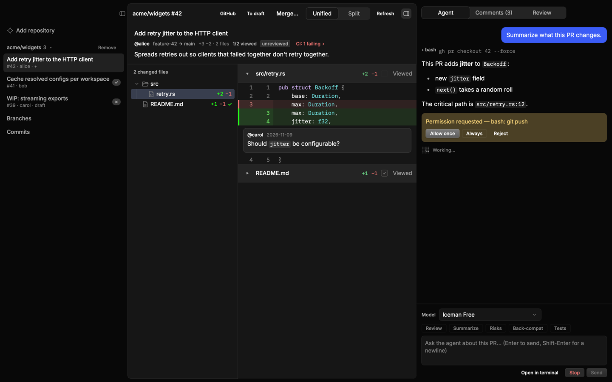

<p align="center">
  
</p>

<h1 align="center">gitsnack</h1>

<p align="center">
  <a href="https://github.com/vangheem/gitsnack/releases/latest"></a>
  <a href="https://github.com/vangheem/gitsnack/actions/workflows/ci.yml"></a>
  <a href="LICENSE"></a>
</p>

A native desktop app for reviewing GitHub pull requests, with an
[opencode](https://opencode.ai) agent built into each review. It's built with
[Rune](https://github.com/anomalyco/rune), a GPU-rendered Rust UI framework.

Instead of opening GitHub to find what needs your review, then opening a terminal and asking
an agent about the PR, gitsnack puts both in one window: the PR list, the diff, the
conversation, your review, and an agent session that already knows which PR you're looking
at.



## Features

**Repositories**
- Track repos by `owner/name` or GitHub URL. gitsnack keeps its own clone of each one
  (under `~/.local/share/gitsnack/repos/`), so your working copies are never touched.
- Open PRs, branches (compared with the default branch), commits and commit ranges.
- Repos refresh in the background every 5 minutes; ⌘R refreshes now.

**Reviewing**
- Unified or split diffs with syntax highlighting, and a changed-files tree like GitHub's.
- Mark files **Viewed**. If a later push changes a viewed file, it becomes unviewed again.
- Click **+** on a line (or select a range of line numbers) to write a line comment. Line
  comments wait as a pending review until you submit it with **Comment**, **Approve** or
  **Request changes**.
- A **Comments** tab shows the conversation, review summaries and inline comments, which
  also appear under their lines in the diff. Post a PR comment, or comment on the
  selected lines.
- Merge after a check of approval, CI and merge rules; switch a PR between draft and ready.

**Commits and CI**
- Commits on the default branch show a CI status dot, so failing commits stand out.
- Opening a commit shows its message, diff and CI. Click the CI status for every Actions job
  and status check on it, with links to their GitHub pages.
- Each commit gets its own agent session that knows the commit and its failing checks.
  **Fix CI** reads the failing logs, fixes the problem on a `gitsnack/fix-ci-…` branch, runs the
  checks locally and opens a draft PR. It never pushes to the default branch, and it suggests a
  re-run instead when the failure looks flaky. **Explain failure** only diagnoses.

**Agent**
- Each PR gets its own opencode session, run in gitsnack's clone of the repo. Its first
  prompt tells the agent which PR to check out and not to change anything on GitHub.
- PR presets: Review, Summarize, Risks, Back-compat, Tests. Or ask anything, or send a
  diff line to the agent with **Ask agent**.
- Pick the model sessions use (saved across restarts). Approve or reject tool permission
  requests inline.
- **Open in terminal** attaches the opencode TUI to the same session (macOS Terminal).

## Requirements

- [`gh`](https://cli.github.com), logged in (`gh auth login`). All GitHub access goes
  through it.
- `git`.
- [`opencode`](https://opencode.ai) v2 for the agent. gitsnack uses opencode's shared
  background service (the same one the TUI uses) and starts it when it isn't running.

macOS is the main target. Linux builds are provided too; "Open in terminal" is macOS only.

## Install

### Homebrew (macOS and Linux x86_64)

```sh
brew install vangheem/tap/gitsnack
```

This also installs `gh`. Upgrade with `brew upgrade gitsnack`.

#### As a Mac app

```sh
gitsnack install-app      # creates ~/Applications/gitsnack.app
gitsnack uninstall-app    # removes it
```

gitsnack also offers to do this the first time you start it from a terminal. Then open it from
Spotlight, Launchpad or the Dock like any other app.

The app is created on your Mac rather than downloaded, so macOS doesn't block it even though
gitsnack isn't signed. It runs the installed `gitsnack` through Homebrew's version-independent
path, so `brew upgrade` updates the app too, and it picks up your login shell's `PATH`, so it
finds `gh`, `git` and `opencode` when opened from Finder.

### Prebuilt binaries

Tagged releases (`v*`) are on the [releases page](https://github.com/vangheem/gitsnack/releases),
and every push to `main` refreshes the
[`latest` prerelease](https://github.com/vangheem/gitsnack/releases/tag/latest).

| Platform | Asset |
| --- | --- |
| macOS (Apple silicon and Intel) | `gitsnack-macos-universal.tar.gz` |
| Linux x86_64 | `gitsnack-linux-x86_64.tar.gz` |

```sh
curl -L https://github.com/vangheem/gitsnack/releases/latest/download/gitsnack-macos-universal.tar.gz | tar xz
mkdir -p ~/.local/bin && mv gitsnack ~/.local/bin/
```

The binaries aren't signed. Homebrew and `curl` installs work as is; if you download one with
a browser, macOS quarantines it, so clear that with
`xattr -d com.apple.quarantine ~/.local/bin/gitsnack`.

On Linux, `libxkbcommon-x11-0` and a Vulkan driver (e.g. `mesa-vulkan-drivers`) must be
installed.

### From source

Requires Rust; the toolchain version is pinned in `rust-toolchain.toml`, so rustup picks
it up automatically.

```sh
make install          # builds a release binary into ~/.local/bin/gitsnack
make install PREFIX=/usr/local
```

Linux builds also need `libxkbcommon-dev` and `libwayland-dev`.

## Use

Run `gitsnack`, click **Add repository**, and enter `owner/name`. The first add clones the
repo, which can take a while for a big one.

| Key | Action |
| --- | --- |
| ⌘R | Refresh repos and the open diff |
| ⌘I | Show or hide the right panel |
| ⇧⌘B | Show or hide the sidebar |
| j / k | Next / previous hunk |
| ] / [ | Next / previous file |
| ⌘Enter | Add a line comment to the pending review |
| Esc | Close the line comment box |

## Data

Everything gitsnack keeps is under `~/.local/share/gitsnack/` (or `$XDG_DATA_HOME/gitsnack`):

- `state.json`: tracked repos, the opencode session for each PR, viewed files,
  pending line comments and the chosen model.
- `repos/<owner>/<name>`: the managed clones.

Removing a repo in the app stops tracking it but leaves its clone in place.

## Releasing

Run the **Release new version** workflow from the Actions tab (or
`gh workflow run bump-version.yml -f bump=patch`) and pick `patch`, `minor` or `major`.
It bumps the version in `Cargo.toml` and `Cargo.lock`, commits to `main`, and pushes a
`vX.Y.Z` tag. The tag starts the release workflow, which builds the binaries, publishes the
GitHub release and updates the formula in
[vangheem/homebrew-tap](https://github.com/vangheem/homebrew-tap).

Tagging by hand works too, as long as the tag matches the version in `Cargo.toml`.

## Development

```sh
make run      # debug build
make test     # offline tests
make lint     # clippy, warnings as errors
cargo test -- --ignored   # also hit GitHub (via gh) and the local opencode service
```

Rune apps render headlessly, which is handy for checking UI changes without a window:

```sh
cargo run -- --snap out.png --scene demo --size 1440x900 --theme dark
cargo run -- --list-scenes
```

### Layout

- `src/main.rs`: app state, background jobs and all views.
- `src/gh.rs`: GitHub through `gh` (PRs, diffs, comments, reviews, merging).
- `src/git.rs`: read-only git on the managed clones.
- `src/opencode.rs`: client for opencode's local HTTP API.
- `src/store.rs`: persisted state.
- `src/model.rs`: shared types.

## License

MIT
